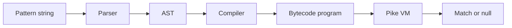

# regex-vm

A linear-time JavaScript regular-expression engine with no backtracking, built on a Pike VM.

## Why this is interesting

Backtracking engines, V8's `RegExp` included, can take exponential time on some patterns. The classic case is
`(a+)+b` run against a long string of `a` with no `b` (a ReDoS, or regular-expression denial of service). Each extra
`a` roughly doubles the number of ways the engine can split the input between the two `+` loops, and it tries them
all before it gives up. The native engine needed about 120 ms for 24 characters in the benchmark below, and the
time grows exponentially with the input.

regex-vm compiles the pattern to bytecode and simulates all alternatives at once with a Pike VM (a Thompson NFA
simulation that tracks capture groups). Each program counter is entered at most once per input position, so the
work is bounded by the input length times the program size. The engine reproduces JavaScript's leftmost,
priority-ordered match semantics, and it is checked against V8 with differential fuzzing.

## Architecture



| Stage | Source | Role |
|---|---|---|
| Parser | `src/parser.ts` | Recursive descent; rejects unsupported syntax with a positioned `RegexSyntaxError` |
| AST | `src/ast.ts` | Discriminated union; every node keeps its source span |
| Compiler | `src/compiler.ts` | Thompson construction; expands counted repetitions; enforces the program size limit |
| Bytecode | `src/program.ts` | `Char`, `Class`, `Any`, `Split`, `Jmp`, `Save`, `ClearCaps`, assertions, `Match` |
| Pike VM | `src/vm.ts` | Runs the program over the input with one thread per program counter, in priority order |

## Quick start

Requires Node.js 22.12 or later.

```sh
git clone https://github.com/xJDvm/regex-vm.git
cd regex-vm
npm install
npm test          # unit, property and differential tests
npm run dev       # playground at http://127.0.0.1:5173
```

The public API is built to `dist/` by `npm run build`. Save the following as `example.mjs` in the repository root
and run `npm run build && node example.mjs`:

```js
import { compile, trace } from "./dist/index.js";

const re = compile("(\\d+)-(?<word>[a-z]+)");
const match = re.exec("order 42-abc");
console.log(match.index, match.end, match.groups, match.named.word);
// 6 12 [ '42-abc', '42', 'abc' ] abc

console.log(re.test("no digits here"));
// false

// One line per input position: the threads waiting there (program counters) and the latest match, if any.
for (const step of trace(compile("a|ab").program, "ab")) {
  console.log(step.pos, step.threads.map((t) => t.pc), step.matched);
}

try {
  compile("(a)\\1");
} catch (error) {
  console.log(error.name, error.message, error.position);
}
// RegexSyntaxError backreferences are not supported at position 3 3
```

## Usage

```ts
import { compile } from "./dist/index.js";

const re = compile("a(b|c)*d");          // throws RegexSyntaxError on unsupported or invalid patterns
console.log(re.source);                  // "a(b|c)*d"

const match = re.exec("xabcbd");         // leftmost match, or null
console.log(match.index, match.end);    // 1 6
console.log(match.groups[0]);            // "abcbd"
console.log(match.groups[1]);            // "b" (text of the last iteration of the group)

console.log(re.exec("xabcbd", 2));       // null: the search starts at offset 2, like lastIndex
console.log(re.test("zzz"));             // false
```

`exec` returns a `Match`:

```ts
interface Match {
  index: number;                              // start of the match
  end: number;                                // end (exclusive)
  groups: (string | undefined)[];             // groups[0] is the whole match
  named: Record<string, string | undefined>;  // named groups
  spans: ([number, number] | undefined)[];    // [start, end] of each group
}
```

`RegexSyntaxError` extends `SyntaxError` and has a `position` field. `compile` accepts only the empty flags string;
see the limitations below.

## Supported and rejected syntax

The engine implements a strict subset of JavaScript's non-Unicode syntax. If regex-vm accepts a pattern, the native
`RegExp` accepts it too.

| Syntax | Status | Notes |
|---|---|---|
| Literals, `.` | Supported | `.` matches any UTF-16 code unit except `\n`, `\r`, `U+2028`, `U+2029` |
| `\d \D \w \W \s \S` | Supported | JavaScript definitions; `\w` is ASCII |
| `\n \r \t \f \v \0` | Supported | `\0` must not be followed by a digit |
| `\xHH`, `\uHHHH`, `\cX` | Supported | Four hex digits for `\u`; no `\u{...}` |
| Escaped syntax characters | Supported | `\^ \$ \\ \. \* \+ \? \( \) \[ \] \{ \} \| \/ \-` |
| `[abc]`, `[a-z]`, `[^...]` | Supported | Escapes allowed inside classes; `\b` inside a class is backspace |
| `(...)`, `(?:...)`, `(?<name>...)` | Supported | Named groups; duplicate names are rejected |
| `a\|b` | Supported | Alternation, leftmost alternative preferred |
| `* + ? {n} {n,} {n,m}` | Supported | Greedy by default; lazy with a trailing `?` |
| `^`, `$` | Supported | Input start and end only; no `m` flag |
| `\b`, `\B` | Supported | ASCII word characters |
| `\1`, `\k<name>` | Rejected | Backreferences |
| `(?=`, `(?!`, `(?<=`, `(?<!` | Rejected | Lookahead and lookbehind |
| Flags other than none | Rejected | Only the empty flags string is accepted |
| Lone `{`, `}`, `]`; `\8`; `\01`; invalid `\x` or `\u` | Rejected | Annex-B leniencies |
| `\p{...}`, `\u{...}` | Rejected | No Unicode mode |
| `{n,m}` with n > m, nothing to repeat, unterminated group or class, out-of-order range | Rejected | Reported with a position |

Limits, all enforced and tested: pattern length 10 000 code units; group nesting depth 500; counted-repetition
bounds up to 1 000; 1 000 capture groups; 50 000 compiled instructions.

## Benchmark

`npm run bench` builds the package and runs `bench/redos.mjs`. The pattern is `(a+)+b` on `"a".repeat(n)`, with no
match, which is the worst case for both engines. Each cell is the median and minimum of 5 repetitions, in
milliseconds.

Measured with Node.js v22.23.5 on Linux x64, Intel Xeon @ 2.10 GHz, 4 logical cores. These are the numbers from a
single run on that machine. `npm run bench` runs the same measurement on yours; expect different numbers.

| Engine | n | median (ms) | min (ms) |
|---|---|---|---|
| native RegExp | 16 | 0.528 | 0.495 |
| native RegExp | 18 | 1.963 | 1.948 |
| native RegExp | 20 | 7.887 | 7.747 |
| native RegExp | 22 | 29.413 | 29.082 |
| native RegExp | 24 | 119.892 | 116.919 |
| regex-vm | 24 | 0.348 | 0.187 |
| regex-vm | 1000 | 2.351 | 1.548 |
| regex-vm | 10000 | 10.289 | 9.916 |
| regex-vm | 100000 | 107.580 | 99.852 |

The native engine is measured only up to n = 24 because its time grows exponentially. The table does not show
typical-pattern performance; this benchmark covers only the ReDoS case.

## Playground

`npm run dev` starts a static Vite app that shows the engine at work:

- A pattern editor, a test string (up to 200 characters), and presets (email-like, named groups, lazy quantifier,
  alternation order, and the `(a+)+b` ReDoS case).
- The bytecode listing, with the active program counters highlighted at each step.
- An NFA graph drawn as SVG, with the active threads as nodes.
- The input tape with the cursor, and a captures table.
- Step, play/pause, speed, and a scrubber over the trace. Syntax errors show a caret under the reported position.
- The result compared with the native `RegExp`. The native run happens in a Web Worker with a 300 ms timeout, so
  the page stays responsive. The panel shows `timed out` or `rejected` when that happens.

Screenshots are not committed. To regenerate them locally, run `SCREENSHOTS=1 npm run e2e`; this needs a Playwright
Chromium (`npx playwright install chromium`, or set `PW_CHROMIUM` to a Chromium binary).

## Design decisions and trade-offs

- **Pike VM instead of backtracking.** Simulating all threads in lockstep gives a bound on the work that does not
  depend on the input's shape. The cost is that the engine cannot support backreferences or lookaround, which
  need backtracking-style matching.
- **Priority order instead of a DFA.** Threads are kept in priority order, so the first match found is the one a
  backtracking engine reports. This keeps JavaScript's leftmost-first results without a lazy DFA. The trade-off is
  that there is no DFA state cache and no literal-prefix acceleration yet.
- **Strict subset.** Annex-B leniencies and unsupported syntax are rejected rather than guessed at. A pattern that
  compiles means the same thing in V8.
- **No recursion in the VM.** `addThread` uses an explicit stack, so large programs do not overflow the call stack.
  The parser's recursion is bounded by the nesting limit.
- **Copy-on-write captures.** A `Save` or `ClearCaps` copies the slot array of the thread. This is simple and
  correct; it adds a factor for the number of slots (see limitations).
- **Compile-time size check.** Counted repetitions are expanded, and the expansion is checked against the
  50 000-instruction limit before any instruction is emitted.
- **Zero runtime dependencies.** The library uses only the platform; test, lint and playground tooling are dev-only.
- **Native comparison in a worker.** V8 can take effectively forever on the ReDoS presets, so the playground runs
  the native `RegExp` in a worker that is terminated after 300 ms.

## Invariants and how they are tested

1. **Errors.** `compile` throws only `RegexSyntaxError`, and `exec` never throws for any string. Tested with
   generated and arbitrary patterns (`test/complexity.test.ts`).
2. **Step bound.** The VM enters at most `(n + 1) · m` program counters, where n is the input length and m the program
   size. Each step copies the slots it writes, so the worst case is O((n + 1) · m · k), with k the number of slots
   and registers. Tested on generated inputs and on fixed ReDoS patterns such as `(a+)+b` (`test/vm.test.ts`,
   `test/complexity.test.ts`).
3. **Same match as V8.** For accepted patterns, `index`, `end` and `groups[0]` equal those of
   `RegExp.prototype.exec`. Checked by differential fuzzing (`test/differential.test.ts`): generated patterns and
   inputs over the alphabet `a b c`, space and newline, with inputs of up to 10 code units and syntax trees up to
   depth 4, 2 000 runs by default. The seed can be set with `FC_SEED`.
4. **Captures.** Captures equal V8's, except for the documented divergence on empty iterations of nullable quantified
   bodies. The differential test skips capture comparison for those trees.

Other property tests: the parser returns or throws only `RegexSyntaxError`; an accepted pattern is also accepted by
`new RegExp`; and `parse(print(ast))` is structurally equal to `ast`.

Unit tests cover the parser and each error message and position, character-class operations, compiler output
(`disassemble` snapshots), VM behaviour (greedy and lazy, alternation priority, anchors, `\b`, capture reset in loops,
named groups, start offsets), and the playground's helpers. Playwright drives the playground end to end.

Run the checks with:

```sh
npm run typecheck
npm run lint
npm test
```

## Limitations

- **Flags.** Only the empty flags string is supported. There is no `i`, `m`, `s`, `g`, `y`, `u` or `v`.
- **Code units, not code points.** Matching works on UTF-16 code units, as JavaScript does without the `u` flag.
  `.` can therefore match half of a surrogate pair.
- **No backreferences or lookaround.** This is by design, to keep the matching bound.
- **Open divergence on nullable loops.** For a `*`, `+` or `{n,}` loop whose body can match the empty string, the
  VM can end a match one iteration early, so `index` and `end` can differ from V8. For example, `(?:.*?)*` against
  `"aa"` matches `"aa"` in V8 but `""` in regex-vm. The divergence is recorded as a failing-by-design test
  (`it.fails`) in `test/vm.test.ts`.
- **Captures on empty iterations.** Captures can differ from V8 for empty iterations of nullable quantified bodies,
  such as `(a*)*` against `""`.
- **Capture cost.** Capture slots are copied on each `Save` and `ClearCaps`, so the worst case is
  O((n + 1) · m · k), not O(n · m).
- **Speed on ordinary patterns.** regex-vm is slower than V8 on typical patterns. The repository does not measure
  that gap; the benchmark covers only the ReDoS case.
- **No optimizations yet.** There is no lazy DFA, no state cache and no literal-prefix acceleration.
- **Playground timeout.** A `timed out` result means the native `RegExp` did not finish within 300 ms. It does not
  mean the native result is wrong.
- **Version 0.1.0.** The API may change before 1.0.

## License

MIT. See [LICENSE](LICENSE). Copyright (c) 2026 Juan Diego Valdés M.
